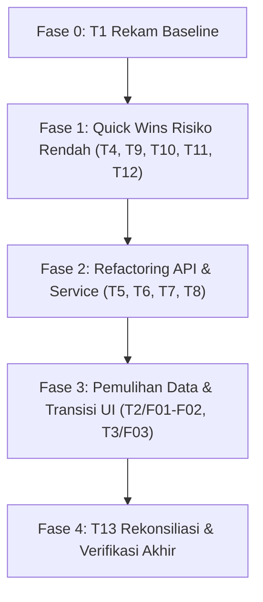

# Task List Detail: Perbaikan & Refactoring Kode

Dokumen ini merupakan turunan teknis operasional dari [laporan-audit-refactoring.md](laporan-audit-refactoring.md) untuk cabang `redesign/glossy-minimal`. Seluruh temuan (`F01`–`F12`) dan rencana eksekusi (`T1`–`T13`) dijabarkan ke dalam sub-tugas yang terukur, lengkap dengan target berkas, nomor baris, desain pengujian (*characterization test*), dan batasan refactoring vs. bugfix.

---

## Ringkasan Eksekusi & Pemisahan Jalur

Pekerjaan dibagi menjadi dua jalur tegas untuk menjaga stabilitas sistem:
1. **Jalur Refactoring Murni**: Menata ulang struktur kode tanpa mengubah perilaku runtime, kontrak API, skema DB, maupun hasil output saat ini.
2. **Jalur Bugfix / Perubahan Kontrak**: Memperbaiki cacat bawaan (`F01`, `F02`, `F03`, pencegahan kebocoran error 500 `F04`, batas paginasi `F05`). Diberi tanda `[Bugfix - Butuh Persetujuan]`.

### Urutan Eksekusi



---

## Fase 0 — Rekam Baseline (`T1`)

Sebelum berkas apapun dimodifikasi, rekam kondisi awal seluruh workspace untuk membedakan *pre-existing issues* dari regresi baru.

### T1 — Rekam Baseline Repo & Matriks Pemeriksaan
- [x] **T1.1 — Catat status Git dan versi toolchain**
  - [x] Rekam commit SHA aktif: `git rev-parse HEAD` (saat audit: `addf266e3694`).
  - [x] Periksa kebersihan working tree: `git --no-optional-locks status --short --branch`.
  - [x] Verifikasi versi toolchain:
    - Node.js: `node -v` (target v22)
    - pnpm: `pnpm -v` (target 9.12.0)
    - Go: `go version` (target 1.26)
- [x] **T1.2 — Rekam baseline paket JavaScript / TypeScript (dari root)**
  - [x] Jalankan `pnpm lint` dan catat semua warning/error bawaan.
  - [x] Jalankan `pnpm typecheck` dan catat exit code.
  - [x] Jalankan `pnpm build` untuk memastikan kompilasi internal `@smm/shared` dan `@smm/ui` berhasil.
  - [x] Jalankan `pnpm test` (menjalankan suite test `@smm/worker`).
- [x] **T1.3 — Rekam baseline modul Go API**
  - [x] Dari root: `make fmt-check`.
  - [x] Dari `apps/api/`: `go vet ./...`.
  - [x] Dari `apps/api/`: `go build ./...`.
  - [x] Dari `apps/api/`: `go test -count=1 ./...` dan catat paket yang di-skip (khususnya `internal/repository` yang butuh `SMM_TEST_DB=1`).
  - [x] Dari `apps/api/`: `go test ./internal/arch` (memastikan aturan isolasi arsitektur bersih).
- [x] **T1.4 — Rekam baseline pemeriksa tautan dokumentasi**
  - [x] Jalankan `python3 -B scripts/check_docs_links.py`.
  - [x] Catat kegagalan lama pada `docs/platforms/youtube.md:60` (tautan `../local-worker/README.md` ditulis relatif dari root repo bukan relatif terhadap direktori dokumen).

---

## Fase 1 — Quick Wins Risiko Rendah (`T4`, `T9`, `T10`, `T11`, `T12`)

Batch ini memiliki tingkat risiko terendah, cakupan diff lokal, dan memvalidasi pipeline CI/CD serta alur testing sebelum menyentuh logika inti.

### T4 (`F08`) — Satukan Serializer Query URL Laporan & Audit
- **Target Berkas:**
  - `apps/web/lib/api.ts` (baris 70–88: `auditQuery`, `reportQuery`)
  - `apps/web/lib/api.ts` (baris 504–523: pemanggil `reportActions`, `reportTargets`, `reportAnalytics`, `reportExportURL`, `listAudit`)
- [x] **T4.1 — Uji karakterisasi fixture serializer**
  - [x] Siapkan matriks input uji:
    1. Objek kosong `{}` → output `""` (string kosong tanpa tanda `?`).
    2. Properti dengan nilai `undefined` dan `""` (string kosong) → diabaikan/skip.
    3. Properti angka nol `{ offset: 0, limit: 0 }` → dipertahankan (`"?offset=0&limit=0"`).
    4. Karakter khusus (spasi, `&`, tanda titik dua) → di-encode via `URLSearchParams`.
    5. Urutan key serialisasi tetap konsisten.
- [x] **T4.2 — Refactor serializer URL**
  - [x] Ganti implementasi `auditQuery` dan `reportQuery` menjadi satu fungsi privat murni:
    ```ts
    function toQueryString(params: AuditQuery | ReportQuery): string {
      const search = new URLSearchParams();
      for (const [key, value] of Object.entries(params)) {
        if (value === undefined || value === '') continue;
        search.set(key, String(value));
      }
      const qs = search.toString();
      return qs ? `?${qs}` : '';
    }
    ```
  - [x] Perbarui pemanggilan di `reportActions`, `reportTargets`, `reportAnalytics`, `reportExportURL`, dan `listAudit` agar menggunakan `toQueryString(params)`.
  - [x] Pertahankan tipe publik `AuditQuery` dan `ReportQuery` tanpa perubahan.
- [x] **T4.3 — Verifikasi**
  - [x] Pastikan output query string identik byte-for-byte dengan hasil baseline T4.1.
  - [x] Jalankan `pnpm --filter @smm/web lint` dan `pnpm --filter @smm/web typecheck`.

---

### T9 (`F09`) — Pusatkan Definisi Event SSE dari Tuple Tunggal
- **Target Berkas:**
  - `packages/shared/src/stream.ts` (baris 20–25: `StreamKind`, baris 58–63: `STREAM_KINDS`)
- [x] **T9.1 — Karakterisasi pemetaan event**
  - [x] Pastikan 4 event terdaftar secara presisi: `'account-updated'`, `'worker-health'`, `'provision-updated'`, `'action-updated'`.
- [x] **T9.2 — Turunkan `StreamKind` dari tuple `as const`**
  - [x] Pindahkan deklarasi array tuple ke atas dan jadikan `as const`:
    ```ts
    const STREAM_KINDS = [
      'account-updated',
      'worker-health',
      'provision-updated',
      'action-updated',
    ] as const;

    export type StreamKind = (typeof STREAM_KINDS)[number];
    ```
  - [x] Pastikan `openHub` dan fungsi listener tetap mendaftarkan listener sesuai urutan elemen dalam tuple.
- [x] **T9.3 — Verifikasi**
  - [x] Jalankan `pnpm --filter @smm/shared build`.
  - [x] Jalankan `pnpm --filter @smm/shared lint` dan `pnpm --filter @smm/shared typecheck`.

---

### T10 (`F10`) — Ekstraksi Duplikasi `SSE_URL` pada Empat Hook Web
- **Target Berkas:**
  - `apps/web/lib/hooks/use-accounts.ts` (baris 9)
  - `apps/web/lib/hooks/use-actions.ts` (baris 9)
  - `apps/web/lib/hooks/use-containers.ts` (baris 11)
  - `apps/web/lib/hooks/use-live-ticker.ts` (baris 7)
- [x] **T10.1 — Definisikan konstanta sentral di modul konfigurasi Web**
  - [x] Tempatkan `export const SSE_URL = process.env.NEXT_PUBLIC_SSE_URL ?? 'http://localhost:24080/api/stream';` pada `apps/web/lib/api.ts` (berdampingan dengan `API_URL`).
  - [x] **Catatan penting:** Pertahankan penulisan statis `process.env.NEXT_PUBLIC_SSE_URL` agar inlining bundler Next.js bekerja, dan pertahankan operator `??` agar string kosong `""` tidak tertimpa default URL.
- [x] **T10.2 — Ganti deklarasi lokal di keempat hook**
  - [x] Hapus `const SSE_URL = ...` dari masing-masing hook dan ganti dengan import dari `../api`.
- [x] **T10.3 — Verifikasi**
  - [x] Verifikasi resolusi URL pada 3 skenario env: `undefined`, `""`, dan kustom URL.
  - [x] Jalankan `pnpm --filter @smm/web lint`, `pnpm --filter @smm/web typecheck`, dan `pnpm --filter @smm/web build`.

---

### T11 (`F11`) — Hilangkan Duplikasi Test Konfigurasi Worker
- **Target Berkas:**
  - `apps/worker/src/test/unit.test.ts` (baris 36–47 dan baris 132–143)
- [x] **T11.1 — Ubah test kedua menjadi pengujian default env kosong**
  - [x] Pertahankan test pertama di baris 36 untuk menguji trimming whitespace dan trailing slash.
  - [x] Ganti test duplikat di baris 132 dengan pengujian fallback default murni saat env kosong `{}`:
    ```ts
    test('loadConfig applies local defaults when environment is empty', () => {
      const cfg = loadConfig({});
      assert.equal(cfg.workerId, 'worker-local');
      assert.equal(cfg.apiUrl, 'http://api:8080');
      assert.equal(cfg.dryRun, true);
      assert.equal(cfg.heartbeatIntervalSec, 30);
      assert.deepEqual(cfg.platforms, ['instagram', 'threads']);
    });
    ```
- [x] **T11.2 — Verifikasi**
  - [x] Jalankan `pnpm --filter @smm/worker test`.
  - [x] Pastikan tidak ada modifikasi pada kode runtime worker (`apps/worker/src/core/config.ts`).

---

### T12 (`F12`) — Hapus Deklarasi Sisa `var _ = errors.New`
- **Target Berkas:**
  - `apps/api/internal/service/analytics.go` (baris 522)
- [x] **T12.1 — Hapus baris deklarasi yang tidak berfungsi**
  - [x] Hapus `var _ = errors.New` di baris 522.
  - [x] Pastikan import `"errors"` tetap dipertahankan karena dipakai oleh `errors.Is` di baris 76.
- [x] **T12.2 — Verifikasi**
  - [x] Dari `apps/api/`: jalankan `go vet ./internal/service/...`, `go build ./...`, dan `go test -count=1 ./internal/service`.

---

## Fase 2 — Refactoring API & Service (`T5`, `T6`, `T7`, `T8`)

Fase ini merapikan kode backend Go pada layer HTTP dan Service tanpa merusak kontrak wire format JSON atau alur SQL.

### T5 (`F05`) — Perjelas Pengecekan Akun Laporan Analytics
- **Target Berkas:**
  - `apps/api/internal/service/report.go` (baris 91–120: `ReportService.AnalyticsReport`)
  - `apps/api/internal/service/report_test.go` (baris 77–104)
- [x] **T5.1 — Characterization Test**
  - [x] Buat unit test pada `report_test.go` yang memastikan:
    1. Filter tanpa `AccountID` → mengembalikan error validasi (`domain.ErrValidation`).
    2. Akun ditemukan pada list (meskipun struct field `Platform` bernilai string kosong `""`) → pemanggilan `AnalyticsTrendByAccount` tetap berjalan.
    3. Akun tidak ditemukan pada list → mengembalikan `domain.ErrNotFound`.
    4. Error dari `ListOfficialAccounts` atau `AnalyticsTrendByAccount` diteruskan dengan pesan terbungkus yang sama.
- [x] **T5.2 — Refactoring Murni: Ganti Pointer Platform dengan Boolean**
  - [x] Ubah blok baris 103–113 pada `report.go`:
    ```go
    accountFound := false
    for _, account := range accs {
        if account.ID == *f.AccountID {
            accountFound = true
            break
        }
    }
    if !accountFound {
        return "", nil, fmt.Errorf("%w: unknown official account", domain.ErrNotFound)
    }
    ```
  - [x] Jalankan `go test -count=1 ./internal/service -run 'TestAnalyticsReport'`.
- [x] **T5.3 — [Bugfix - Butuh Persetujuan] Batas Paginasi 100 Akun**
  - *Masalah:* `ListOfficialAccounts(ctx, nil, nil)` menerapkan paginasi default 100 akun (`LIMIT 100 OFFSET 0`). Akun ke-101 tidak akan bisa dibuatkan laporannya (404).
  - *Opsi Solusi:* Mengganti pemanggilan list dengan method pencarian ID langsung pada store `GetOfficialAccountByID(ctx, *f.AccountID)` dan memastikan status bukan `ARCHIVED`.

---

### T6 (`F07`) — Satukan Mapper Pointer Nullable ke Generic Helper
- **Target Berkas:**
  - `apps/api/internal/http/analytics.go` (baris 268–287: `nullStr`, `nullTime`, `nullInt64`, baris 349–354: `nullFloat64`, baris 322–370: pemanggil)
  - `apps/api/internal/http/analytics_test.go` (baris 261–295)
- [x] **T6.1 — Perkuat Assertion JSON Mentah pada Test**
  - [x] Di `analytics_test.go`, selain decode ke struct, decode response HTTP ke `map[string]json.RawMessage`.
  - [x] Verifikasi bahwa atribut nullable (`saves`, `shares`, `likes`, `comments`, `engagementRatePct`) **hadir dalam JSON dengan nilai `null`** ketika pointer `nil` (bukan hilang dari JSON), dan menghasilkan angka/string ketika pointer terisi.
- [x] **T6.2 — Implementasikan Helper Generic**
  - [x] Tambahkan fungsi generik pada `apps/api/internal/http/analytics.go`:
    ```go
    func nullableFromPtr[T any](p *T) nullable.Nullable[T] {
        if p == nil {
            return nullable.NewNullNullable[T]()
        }
        return nullable.NewNullableWithValue(*p)
    }
    ```
  - [x] Hapus fungsi khusus `nullStr`, `nullTime`, `nullInt64`, dan `nullFloat64`.
  - [x] Ubah seluruh pemanggil di `toIngestionRunDTO`, `toContentMetricDTOs`, dan `toBreakdownDTOs` untuk menggunakan `nullableFromPtr`.
- [x] **T6.3 — Verifikasi**
  - [x] Jalankan `go test -count=1 ./internal/http -run 'TestAnalytics'`.

---

### T7 (`F06`) — Ekstraksi Pemetaan Baris CSV pada `exportCSV`
- **Target Berkas:**
  - `apps/api/internal/service/report.go` (baris 194–242: `exportCSV`)
  - `apps/api/internal/service/report_test.go` (baris 106–166)
- [x] **T7.1 — Karakterisasi Golden Output CSV**
  - [x] Perluas `TestExportCSVStreamsRows` untuk menguji:
    1. Golden bytes header dan baris untuk `ExportActions`, `ExportTargets`, dan `ExportAnalytics`.
    2. Format penanggalan: `time.DateOnly` untuk actions, `time.RFC3339` untuk analytics.
    3. Penanganan nilai kosong, koma, kutip, dan angka 0.
    4. Perilaku saat query error: header tetap tertulis karena `cw.Write(header)` dipanggil sebelum query dan `defer cw.Flush()` tetap berjalan.
- [x] **T7.2 — Ekstraksi Mapper Baris ke Fungsi Murni**
  - [x] Buat 3 fungsi privat murni di `report.go`:
    - `actionCSVRow(r ActionRow) []string`
    - `targetCSVRow(r TargetRow) []string`
    - `analyticsCSVRow(accountID, metric string, p domain.TrendPoint) []string`
  - [x] Ganti pembentukan slice string inline di `exportCSV` dengan memanggil ketiga fungsi di atas.
  - [x] Pertahankan urutan eksekusi, penanganan error, dan flush writer agar tidak mengubah kontrak.
- [x] **T7.3 — Verifikasi**
  - [x] Jalankan `go test -count=1 ./internal/service -run 'Test(Export|ActionReport|AnalyticsReport|ReportEmail)'`.

---

### T8 (`F04`) — Sederhanakan Ekstraksi Pesan Error HTTP
- **Target Berkas:**
  - `apps/api/internal/http/errors.go` (baris 60–73: `errorHandler`)
  - `apps/api/internal/http/audit.go` (baris 87–94: `translateAuditError`)
  - `apps/api/internal/http/errors_test.go`
- [x] **T8.1 — Characterization Test Matriks Status & Pesan**
  - [x] Tambahkan unit test di `errors_test.go` yang memeriksa pasangan `(status, error.code, error.message)` untuk:
    1. Error Go biasa → `500`, `code: "internal"`, `message: "Internal Server Error"`.
    2. Domain sentinel (mis. `ErrNotFound`) → `404`, `code: "not_found"`, `message: "Not Found"`.
    3. `echo.NewHTTPError(409, "custom msg")` → `409`, `code: "custom msg"`, `message: "custom msg"`.
    4. `echo.NewHTTPError(400, "")` (pesan kosong) → `400`, `code: "internal"`, `message: "Bad Request"`.
    5. `echo.NewHTTPError(500, "custom 500")` → `500`, `code: "custom 500"`, `message: "Internal Server Error"`.
- [x] **T8.2 — Refactoring Ekstraksi Pesan Echo**
  - [x] Ekstrak pesan Echo satu kali untuk menghindari redundansi type assertion:
    ```go
    var he *echo.HTTPError
    var explicitMessage string
    if errors.As(err, &he) {
        httpStatus = he.Code
        explicitMessage, _ = he.Message.(string)
        if explicitMessage != "" {
            code = explicitMessage
        }
    }

    message := http.StatusText(httpStatus)
    if explicitMessage != "" && httpStatus >= 400 && httpStatus < 500 {
        message = explicitMessage
    }
    ```
  - [x] Jalankan `go test -count=1 ./internal/http -run 'Test(ErrorHandler|ExplicitConflict)'`.
- [x] **T8.3 — [Bugfix - Butuh Persetujuan] Mencegah Kebocoran Pesan Internal pada Status 500**
  - *Masalah:* `translateAuditError` di `audit.go:92` meneruskan `err.Error()` ke dalam `echo.NewHTTPError(500, err.Error())`. Handler menyalin pesan ini ke `error.code`, sehingga pesan kegagalan query/database internal terekspos ke klien.
  - *Opsi Solusi:*
    1. Pada `audit.go`, kembalikan error asli `err` tanpa dibungkus `echo.NewHTTPError` agar jatuh ke mapping default 500.
    2. Pada `errors.go`, batasi penimpaan variabel `code = explicitMessage` hanya jika `httpStatus < 500`.

---

## Fase 3 — Pemulihan Data & Transisi UI Asinkron (`T2`, `T3`)

Batch ini memerlukan kehati-hatian tinggi karena melibatkan operasi destruktif (`drill.sh` / `restore.sh`) dan race condition UI di browser.

### T2 (`F01` & `F02`) — Karakterisasi & Perbaikan Skrip Pemulihan Data
- **Target Berkas:**
  - `infra/backup/drill.sh` (baris 39–42, 48–68)
  - `infra/backup/restore.sh` (baris 12–18, 112–116)
  - `infra/backup/lib.sh` (baris 9–16)
- [x] **T2.1 — Pengujian Offline F01 (Resolusi Path Relatif vs Absolut)**
  - [x] Buat skrip uji mandiri tanpa Docker untuk menguji evaluasi variabel:
    ```bash
    # Kasus nama backup relatif (restore mandiri):
    name="latest" -> SRC="$BACKUP_DIR/$name" (Valid)
    # Kasus path absolut dari drill.sh (baris 41):
    SRC="$(cd "$BACKUP_DIR/latest" && pwd)"
    # Evaluasi di restore.sh:
    name="$SRC" -> SRC="$BACKUP_DIR/$name" -> menghasilkan prefix ganda!
    ```
  - [x] Pastikan bug ini terkarakterisasi dan tercatat sebagai cacat terbuka sebelum diubah.
- [x] **T2.2 — Pengujian Sintaks Parser F02 (Unterminated Quote)**
  - [x] Uji string perintah baris 114 dari `restore.sh`:
    `find /sessions -type f 2>/dev/null | wc -l | tr -d " `
  - [x] Pipa string tersebut ke `/bin/sh -n` dan verifikasi bahwa parser gagal dengan exit code 2.
- [x] **T2.3 — [Bugfix - Butuh Persetujuan] Perbaikan Path F01 & Pre-flight Wipe**
  - [x] Di `infra/backup/restore.sh`: Tangani kemungkinan argumen berupa path absolut:
    ```bash
    name="${1:-latest}"
    if [[ "$name" = /* ]]; then
      SRC="$name"
    else
      SRC="$BACKUP_DIR/$name"
    fi
    [ -L "$SRC" ] && SRC="$(cd "$SRC" && pwd)"
    [ -d "$SRC" ] || die "backup not found: $SRC (run 'make backup' first)"
    [ -f "$SRC/postgres.dump" ] || die "missing postgres.dump in $SRC"
    [ -f "$SRC/manifest.txt" ] || die "missing manifest.txt in $SRC"
    ```
  - [x] Di `infra/backup/drill.sh`: Validasi kelengkapan backup (`postgres.dump` dan `manifest.txt`) **sebelum** perintah destruktif `docker compose down` dan penghapusan volume `docker volume rm`.
- [x] **T2.4 — [Bugfix - Butuh Persetujuan] Perbaikan Tanda Kutip F02**
  - [x] Di `infra/backup/restore.sh` baris 114:
    Tutup tanda kutip pada `tr -d " "`:
    ```bash
    got_sessions="$("${COMPOSE[@]}" run --rm --no-deps -v "$VOL_SESSIONS:/sessions:ro" \
      --entrypoint /bin/sh "$SVC_DB" -c 'find /sessions -type f 2>/dev/null | wc -l | tr -d " "')"
    ```
  - [x] Jalankan `bash -n infra/backup/*.sh` dan pastikan lolos exit code 0.

---

### T3 (`F03`) — Sinkronisasi Atomik Jenis & Hasil Laporan di Frontend
- **Target Berkas:**
  - `apps/web/app/(dashboard)/reports/page.tsx` (baris 53–56, 191–207, 212–344)
  - `apps/web/lib/hooks/use-reports.ts` (baris 25–56)
- [x] **T3.1 — Karakterisasi & Reproduksi Transisi Jenis Laporan**
  - [x] Rekam skenario pergantian filter laporan:
    1. State awal: `kind = 'targets'`, respons berhasil diterima (`result` berupa `{ rows: [...] }`).
    2. Pengguna mengganti dropdown ke `kind = 'analytics'`.
    3. Respons network untuk analytics tertahan (delay 500ms).
    4. Selama masa tunggu, `ReportBody` dieksekusi dengan `kind = 'analytics'`, tetapi `result` masih berisi payload targets.
    5. Terjadi runtime error pada `report.series.length` karena `series` berstatus `undefined` pada `TargetReport`.
- [x] **T3.2 — [Bugfix - Butuh Persetujuan] Pengikatan Atomik `kind` dan Payload Data**
  - [x] Di `use-reports.ts`, bungkus state hasil ke dalam pasangan jenis dan data (*tagged union*):
    ```ts
    export type TaggedReportResult =
      | { kind: 'actions'; data: ActionReport }
      | { kind: 'targets'; data: TargetReport }
      | { kind: 'analytics'; data: AnalyticsReport };
    ```
  - [x] Saat transisi atau loading, kosongkan atau pertahankan pasangan `result` sebelumnya secara konsisten sehingga `ReportBody` hanya merender komponen yang sesuai dengan `result.kind`.
  - [x] Hapus type casting tidak aman (`result as ActionReport`, `result as TargetReport`, `result as AnalyticsReport`) pada `ReportBody`.
- [x] **T3.3 — Verifikasi**
  - [x] Jalankan `pnpm --filter @smm/web lint` dan `pnpm --filter @smm/web typecheck`.
  - [x] Uji transisi antar jenis laporan dengan simulasi network throttling.

---

## Fase 4 — Rekonsiliasi & Verifikasi Akhir (`T13`)

### T13 — Rekonsiliasi Diff dan Verifikasi Regresi
- [x] **T13.1 — Audit Kebersihan Git Diff**
  - [x] Jalankan `git status --short --untracked-files=all`.
  - [x] Jalankan `git diff --stat` dan `git diff --check`.
  - [x] Pastikan tidak ada perubahan liar pada berkas skema OpenAPI (`openapi/openapi.yaml`), query SQL (`apps/api/db/queries/*.sql`), lockfile (`pnpm-lock.yaml`), maupun generated types.
- [x] **T13.2 — Eksekusi Matriks Uji Lengkap (Clean State)**
  - [x] Eksekusi checklist pemeriksaan dari root:
    ```bash
    pnpm lint
    pnpm typecheck
    pnpm build
    pnpm test
    make fmt-check
    ```
  - [x] Eksekusi checklist Go dari `apps/api/`:
    ```bash
    go vet ./...
    go build ./...
    go test -count=1 ./...
    go test ./internal/arch
    ```
  - [x] Eksekusi verifikasi skrip shell pemulihan:
    ```bash
    bash -n infra/backup/lib.sh infra/backup/backup.sh infra/backup/restore.sh infra/backup/drill.sh
    ```
  - [x] Bandingkan hasil akhir dengan catatan baseline pada `T1`. Pastikan semua pengujian lulus dan tidak ada regresi baru.
