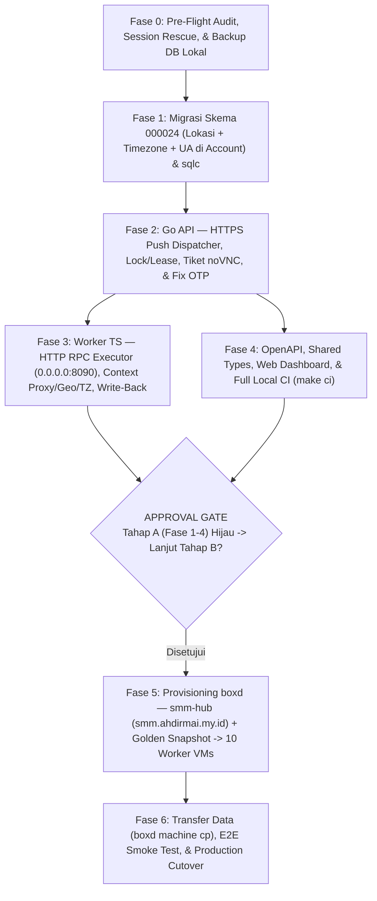

# Stateless Worker Pool (10 Worker Utama di `boxd`) — Master Plan & Dokumentasi

**Tanggal Penyusunan:** 5 November 2026  
**Target Sistem:** MVP-1-SMM (`apps/api`, `apps/worker`, `apps/web`) di atas Infrastruktur **`boxd` MicroVM (`fra`)**  
**Domain Produksi Terkunci:** `https://smm.ahdirmai.my.id` (`smm-hub`)  
**Skala Data Saat Ini:** 486 Akun Live (485 Instagram, 1 Threads)  
**Referensi Infra:** Catatan Infrastruktur `boxd` (`boxd-recap-smm-migration.md`)  
**Strategi Eksekusi:** **2 Tahap Ber-Gate** (**Tahap A:** Fase 1–4 Aplikasi & CI Lokal -> *Approval Gate* -> **Tahap B:** Fase 5–6 Provisioning `boxd` & Cutover)  
**Status Implementasi:** *Planning Locked & Ready*

---

## 1. Visi Arsitektur Terintegrasi (App + `boxd` Infra)

Catatan infrastruktur `boxd` mengonfirmasi kepingan puzzle terakhir yang membuat desain **"10 Worker Utama + Credentials & Location Dikirim Saat Running"** menjadi **100% klop secara teknis dan sangat hemat biaya**:

1. **Control Plane Tunggal (`smm-hub` — `boxd` `2vCPU/8G` di `fra`, Always-On):**
   - Menjalankan PostgreSQL (Vault terenkripsi AES-256-GCM untuk seluruh 486+ akun: `password_enc`, `account_session.storage_state`, `proxy_group`, `location`, `latitude/longitude`, `timezone`, `user_agent`), Redis, MinIO, Go API, Next.js (`HOSTNAME=0.0.0.0`), dan `nginx:8000`.
2. **10 Worker Utama (`smm-worker-01` s/d `smm-worker-10` — `boxd` `2vCPU/8G` di `fra`, Auto-Sleep & Instant Wake):**
   - Dibuat dari **1 Golden Snapshot (`smm-worker-golden`)** dalam `<200 ms` tanpa Docker-in-Docker (langsung Ubuntu 24.04 + Xvfb + x11vnc + noVNC + Playwright Chromium + `pm2` + `nginx:8000`).
   - Dikonfigurasi dengan `bot-protection=off`, `idle.ignore-outbound=on`, `auto-suspend.timeout=300` (5 menit), dan `auto-hibernate.timeout=3600` (1 jam).
   - **Saat sepi, ke-10 worker otomatis masuk `standby`/`hibernated` (biaya CPU & RAM = $0!).**
3. **Push-on-Run over HTTPS TLS (Bukan `BLPOP` Pull Loop):**
   - Di `boxd`, worker yang `hibernated` tidak bisa melakukan `BLPOP` ke Redis, sedangkan worker yang terus-menerus polling Redis tidak akan pernah bisa tidur (boros kredit).
   - Solusinya persis seperti ide awal Anda: **ketika ada job/login yang siap jalan, Go API di `smm-hub` mengirimkan payload aksi + session/credentials + lokasi GPS + proxy melalui request HTTPS masuk (`POST https://rpc.smm-worker-XX.boxd.sh/internal/execute-action`)**.
   - Koneksi HTTPS masuk tersebut **otomatis membangunkan microVM `boxd` dalam `<1 ms` (dari standby) atau `±85 ms` (dari hibernated)**, mengeksekusi aksi di `BrowserContext` terisolasi, mengembalikan cookie `storageState()` terbaru + bukti screenshot di callback, menutup context hingga bersih, dan membiarkan VM kembali tidur saat antrean selesai!

---

## 2. Daftar Dokumen dalam Folder Ini

| No | Dokumen | Cakupan Pembahasan |
| :-: | :--- | :--- |
| **00** | [**task-list.md**](./task-list.md) | **Master Execution Checklist (SSOT untuk Coding Agent):** 43 task atomik berurutan (`T0.1`–`T6.5`), guardrails wajib, spesifikasi file/kode presisi, & gate CI per fase. |
| **01** | [`01-RESEARCH-ARCHITECTURE.md`](./01-RESEARCH-ARCHITECTURE.md) | Riset kelayakan, sinergi Push-on-Run dengan `boxd` Auto-Suspend/Hibernate, realita ASN `AS396356 (Latitude.sh)` & strategi Proxy/Timezone Indonesia, serta keamanan noVNC publik. |
| **02** | [`02-DATABASE-AND-DATA-MIGRATION.md`](./02-DATABASE-AND-DATA-MIGRATION.md) | Migrasi SQL `000024` (lokasi, GPS, `timezone`, `user_agent` di `account`), penyelamatan session & transfer DB/MinIO ke `boxd` via `boxd machine cp` + verifikasi SHA-256. |
| **03** | [`03-BACKEND-API-AND-ORCHESTRATION.md`](./03-BACKEND-API-AND-ORCHESTRATION.md) | Desain `WorkerRPCClient` (HTTPS Push), Redis Account Lock & Worker Lease, tiket HMAC noVNC, serta fix bug eksisting (`stopOTPWorker`, `MaxCallbackBytes`, `AccountsByRegion`). |
| **04** | [`04-WORKER-AND-FRONTEND-IMPLEMENTATION.md`](./04-WORKER-AND-FRONTEND-IMPLEMENTATION.md) | Refactor TypeScript Worker menjadi HTTP RPC Server (`0.0.0.0:8090`), injeksi `storageState` + `geolocation` + `timezoneId` + `proxy` per-context, perubahan OpenAPI, & UI Next.js (`0.0.0.0`). |
| **05** | [`05-EXECUTION-ROADMAP-TESTING-ROLLBACK.md`](./05-EXECUTION-ROADMAP-TESTING-ROLLBACK.md) | Urutan kerja terarah (**Fase 0 s/d Fase 6**), matriks pengujian otomatis & live di `boxd`, prosedur *cutover*, serta rencana *rollback* cepat. |
| **06** | [`06-BOXD-INFRA-DEPLOYMENT-RUNBOOK.md`](./06-BOXD-INFRA-DEPLOYMENT-RUNBOOK.md) | Panduan teknis `boxd`: topologi VM, pembuatan Golden Snapshot, `nginx:8000` dispatch, aturan `pm2` + `.boxenv`, penanganan jebakan `boxd`, manajemen secret tanpa bocor ke log/chat, & estimasi kredit $150. |
| **07** | [`boxd-recap-smm-migration.md`](./boxd-recap-smm-migration.md) | Catatan referensi infrastruktur `boxd` dari tim infra (pola mesin produksi eksisting, jebakan terverifikasi, aturan DNS Cloudflare, dan keamanan kredensial). |
| **08** | [**08-MIGRATION-AUDIT-PLAN.md**](./08-MIGRATION-AUDIT-PLAN.md) | **Rencana Audit Hasil Implementasi & Migrasi (2-Gate Audit):** Daftar 7 *suspect hotspots* awal (`S1`–`S7`), matriks audit lokal Tahap A (`A1`–`A7`), matriks audit cloud `boxd` Tahap B (`B1`–`B6`), & kriteria *Go/No-Go*. |

---

## 3. Peta Alur Implementasi End-to-End

---

## 4. Ringkasan 9 Temuan Kritis (Kode + Infra `boxd`) yang Ditangani Plan Ini

1. **Jebakan `BLPOP` vs Hibernasi `boxd`:** Worker yang polling Redis tidak bisa tidur (boros kredit) dan saat hibernasi tidak bisa bangun sendiri. Diubah menjadi **HTTPS Push** dari `smm-hub` ke `https://smm-worker-XX.boxd.sh` yang membangunkan VM otomatis dalam `<1–85 ms`.
2. **Jebakan `bot-protection` Default ON di `boxd`:** Wajib set `bot-protection off` (dan/atau subdomain proxy `rpc.smm-worker-XX.boxd.sh`) agar request Go API tidak diblokir challenge edge `boxd`.
3. **Keamanan noVNC di URL Publik `*.boxd.sh`:** Berbeda dengan `localhost:24100` di Mac, URL `boxd.sh` terbuka ke internet publik. Wajib dilindungi tiket HMAC berumur pendek yang diverifikasi `nginx` / worker sebelum membuka WebSocket layar browser!
4. **Mismatch Timezone Frankfurt (`fra`) vs GPS Indonesia:** Mesin `boxd` berada di `fra` (`UTC`/`CET`), sedangkan akun memakai GPS kota Indonesia (`Jakarta`/`Makassar`). Wajib meng-inject `timezoneId` (`Asia/Jakarta` / `Asia/Makassar`) pada `browser.newContext()` agar tidak terdeteksi anomali oleh Meta.
5. **Realita Egress `AS396356 (Latitude.sh)`:** Ke-10 VM memiliki IP berbeda namun satu ASN datacenter. Plan mendukung **Mode Proxy Residensial per-Context** (untuk 486 akun) maupun **Sticky Worker Affinity** (untuk pemisahan akun per mesin).
6. **Jebakan Bind `127.0.0.1` -> Error `502` di `boxd`:** Seluruh proses yang diekspos (`nginx:8000`, Next.js standalone `HOSTNAME=0.0.0.0`) wajib bind ke `0.0.0.0`.
7. **Bahaya `stopOTPWorker` di [`job.go`](../../apps/api/internal/service/job.go):** Dihapus pada mode pool agar error OTP 1 akun tidak mematikan VM worker bersama.
8. **Batas `MaxCallbackBytes = 64 KiB` di [`internal.go`](../../apps/api/internal/http/internal.go):** Dinaikkan ke `2 MiB` agar write-back `storageState()` Instagram + bukti screenshot `.jpg` tidak gagal HTTP `413`.
9. **Batasan Proxy `socks5://` Ber-Auth di Playwright `1.48.2`:** Diverifikasi hanya mengizinkan `http://` atau `https://` ketika memakai `username:password` di level `BrowserContext`.
